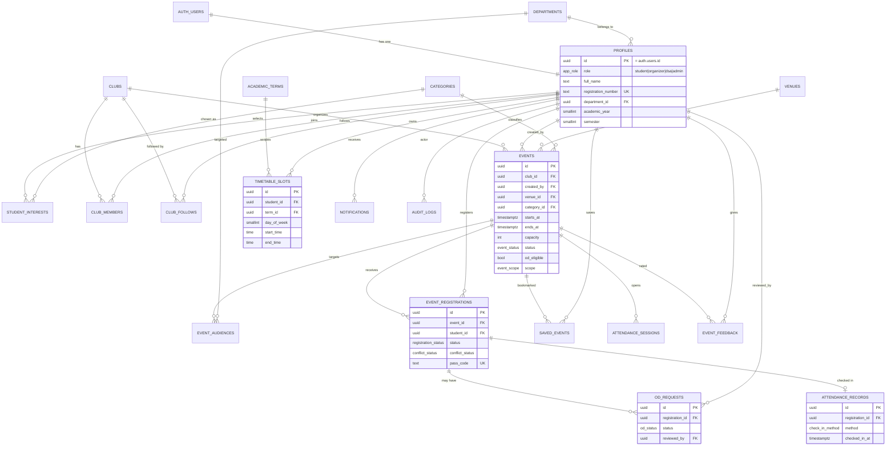
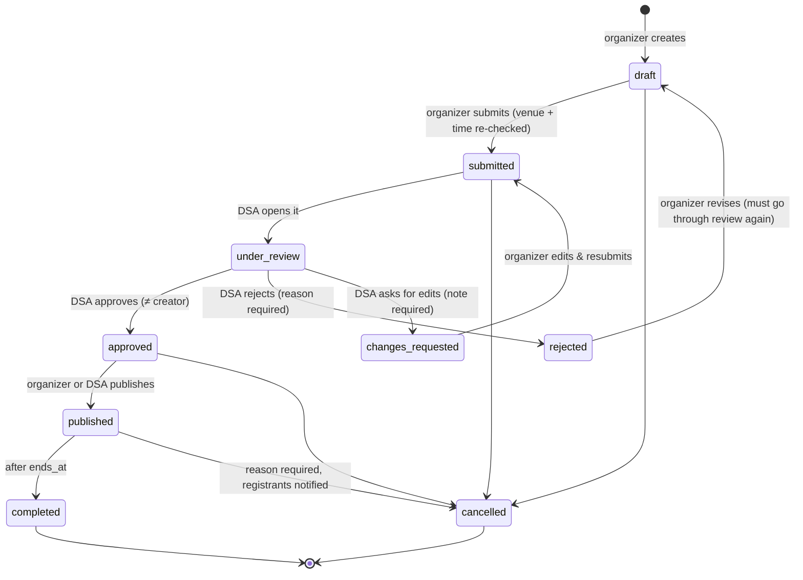

# CampusSync — Database Schema Proposal (DRAFT)

> **Status:** Approved 2026-11-11 (all D1–D9 recommendations accepted). Implemented in `supabase/migrations/`. D9 is implemented as "cancel until `registration_closes_at`".
>
> Diagrams use **Mermaid**. They render on GitHub, and in VS Code with the "Markdown Preview Mermaid Support" extension.

---

## 0. Vocabulary (read this first)

| Term | Meaning in one line |
|---|---|
| **Table** | A spreadsheet-like structure. Each **row** is one record, each **column** is one property. |
| **Primary key (PK)** | The column that uniquely identifies a row (here, almost always `id`). |
| **Foreign key (FK)** | A column that points to another table's PK. The DB refuses values that don't exist there. |
| **UUID** | A random 128-bit ID like `3f2a…`. It can't be guessed, unlike 1, 2, 3, which lets someone try "the next record". |
| **Unique constraint (UK)** | The DB refuses two rows with the same value(s), e.g. two active registrations by one student for one event. |
| **CHECK constraint** | A rule on a row's values, e.g. `ends_at > starts_at`. |
| **Enum** | A column that may only hold values from a fixed list, e.g. `student / organizer / dsa / admin`. |
| **Lookup table** | A small table of allowed values that admins can edit (departments, categories). |
| **Junction table** | A table that connects two others in a many-to-many relationship (student ↔ category = interests). |
| **`timestamptz`** | A timestamp with time zone. Stored internally in UTC and shown in local time, so there's no confusion about which 10 AM. |
| **ON DELETE** | What happens to child rows when a parent row is deleted: `CASCADE` (delete them too), `RESTRICT` (block the delete), or `SET NULL`. |
| **Normalization** | Store each fact **once**. If a department name changes, you update one row, not 2,000 profiles. |

---

## 1. Design principles used

1. **One fact, one place.** Departments, categories and terms are lookup tables, not free text, so "CSE", "C.S.E." and "Computer Science" can't drift apart.
2. **Separate concepts stay separate.** Registration ≠ OD approval ≠ attendance. Three tables, and none of them creates another automatically.
3. **The database enforces the rules**, not just the JavaScript: unique indexes, CHECKs, an exclusion constraint for venues, and RLS (Stage 4).
4. **Soft state, not deletes**, for anything with history. Registrations get `status = cancelled` and aren't deleted, so analytics and audit stay correct.
5. **All instants are `timestamptz`.** The campus timezone (`Asia/Kolkata`) is stored once in `platform_settings`. Weekly class times are plain `time` values, interpreted in that timezone.
6. **Don't over-build.** 15 core tables plus 3 optional ones (marked ⭘) that exist only because the current UI has a button for them. Cut them if you like.

---

## 2. ER diagram

`||--o{` reads "one … to zero-or-many". `}o--||` reads "many … to exactly one".

---

## 3. Enums (fixed value lists)

| Enum | Values | Notes |
|---|---|---|
| `app_role` | `student`, `organizer`, `dsa`, `admin` | Signup always gets `student`. |
| `event_status` | `draft`, `submitted`, `under_review`, `changes_requested`, `approved`, `rejected`, `published`, `completed`, `cancelled` | One lifecycle column (see §6, decision D1). |
| `event_type` | `workshop`, `hackathon`, `seminar`, `competition`, `cultural`, `sports`, `guest_lecture`, `club_activity`, `other` | *What kind* of event. |
| `event_scope` | `club`, `department`, `university` | *How big*. Drives campus-wide warnings. |
| `registration_status` | `registered`, `cancelled` | A waitlist is a future extension. |
| `conflict_status` | `no_conflict`, `partial_conflict`, `full_conflict`, `timetable_not_configured` | Snapshot saved at registration time. |
| `od_status` | `pending`, `approved`, `rejected`, `withdrawn` | |
| `check_in_method` | `qr`, `manual` | |
| `membership_role` | `lead`, `coordinator`, `member` | Only `lead`/`coordinator` can manage club events. |
| `membership_status` | `active`, `pending`, `inactive` | |

---

## 4. Tables

Legend: **PK** primary key · **FK** foreign key · **UK** unique · **NN** NOT NULL · ⭘ optional table

### 4.1 Reference / lookup tables

#### `departments`
| Column | Type | Rules |
|---|---|---|
| id | uuid | PK |
| code | text | NN, UK (e.g. `CSE`) |
| name | text | NN, UK (e.g. `Computer Science & Engineering`) |

*Why:* used by profiles, clubs and event audiences. Free text would break "events for CSE year 2" matching.

#### `categories`
| Column | Type | Rules |
|---|---|---|
| id | uuid | PK |
| name | text | NN, UK (`Technology`, `Hackathons`, `Entrepreneurship`, `Arts & Culture`, `Music`, `Research`, …) |
| slug | text | NN, UK (`arts-culture`) |
| sort_order | smallint | default 0 |

*Why:* the same list powers the landing tabs, the discover filter, student interests and recommendations.

#### `academic_terms`
| Column | Type | Rules |
|---|---|---|
| id | uuid | PK |
| name | text | NN, UK (`2026-27 Odd Semester`) |
| starts_on / ends_on | date | NN, CHECK `ends_on > starts_on` |

*Why:* a weekly timetable only applies between term dates. Without this, a December event would be checked against a timetable that ended in November. It also lets the conflict checker say **"timetable not configured"** when the student has no slots for the term the event falls in.

#### `platform_settings`
| Column | Type | Rules |
|---|---|---|
| key | text | PK (e.g. `campus_timezone`, `od_reviewer_roles`, `campus_warning_rules`) |
| value | jsonb | NN |
| updated_by | uuid | FK → profiles, ON DELETE SET NULL |
| updated_at | timestamptz | NN |

*Why:* this is where configurable rules live without code changes. Examples: who reviews OD (default `["dsa"]`), the timezone, and the minimum scope that triggers campus-wide warnings.

---

### 4.2 Users

#### `profiles` — one row per account (1:1 with `auth.users`)
| Column | Type | Rules |
|---|---|---|
| id | uuid | PK, FK → `auth.users.id` ON DELETE CASCADE |
| role | app_role | NN, default `student`. **Users can never update this column themselves.** |
| full_name | text | NN, CHECK length 2–100 |
| email | text | NN, UK. Copied from `auth.users` by a trigger, read-only |
| registration_number | text | UK, nullable (staff don't have one) |
| department_id | uuid | FK → departments, ON DELETE RESTRICT |
| academic_year | smallint | CHECK 1–5, nullable |
| semester | smallint | CHECK 1–10, nullable |
| phone_number | text | nullable, **private** |
| avatar_url | text | nullable |
| is_active | boolean | NN, default true (admins deactivate instead of deleting) |
| created_at / updated_at | timestamptz | NN |

*Why separate from `auth.users`:* Supabase owns `auth.users` (passwords, login data), and your app shouldn't touch it. `profiles` holds *your* data, with the same id, so the two link one-to-one. **Passwords are never stored here.**

#### `student_interests` (junction: profile ↔ category)
| Column | Type | Rules |
|---|---|---|
| student_id | uuid | FK → profiles ON DELETE CASCADE |
| category_id | uuid | FK → categories ON DELETE CASCADE |
| created_at | timestamptz | NN |
| | | **PK (student_id, category_id)**, so the same interest can't be stored twice |

---

### 4.3 Clubs

#### `clubs`
| Column | Type | Rules |
|---|---|---|
| id | uuid | PK |
| name | text | NN, UK |
| short_name | text | e.g. `IE` (used for the logo badge in the UI) |
| description | text | |
| category_id | uuid | FK → categories, nullable |
| department_id | uuid | FK → departments, nullable (department clubs) |
| logo_url | text | nullable |
| status | text | CHECK in (`active`, `inactive`), default `active` |
| created_at / updated_at | timestamptz | NN |

#### `club_members` — who runs or belongs to a club
| Column | Type | Rules |
|---|---|---|
| id | uuid | PK |
| club_id | uuid | FK → clubs ON DELETE CASCADE |
| user_id | uuid | FK → profiles ON DELETE CASCADE |
| membership_role | membership_role | NN, default `member` |
| membership_status | membership_status | NN, default `active` |
| created_at | timestamptz | NN |
| | | **UK (club_id, user_id)** |

*Organizer permission rule (proposed):* a user may manage a club's events **only if** `profiles.role = 'organizer'` **and** they have an `active` row here with role `lead` or `coordinator`. Two independent checks (defence in depth): an admin grants the *role*, and the *club scope* comes from membership.

#### ⭘ `club_follows` — powers the "Follow +" button
| Column | Type | Rules |
|---|---|---|
| student_id | uuid | FK → profiles ON DELETE CASCADE |
| club_id | uuid | FK → clubs ON DELETE CASCADE |
| created_at | timestamptz | NN |
| | | **PK (student_id, club_id)** |

*Why not `club_members`?* Following needs no approval and gives no rights. Mixing the two would let a follower look like a member.

---

### 4.4 Venues & events

#### `venues`
| Column | Type | Rules |
|---|---|---|
| id | uuid | PK |
| name | text | NN, UK |
| building | text | |
| capacity | int | NN, CHECK > 0 |
| description | text | |
| is_active | boolean | NN, default true |
| created_at / updated_at | timestamptz | NN |

#### `events`
| Column | Type | Rules |
|---|---|---|
| id | uuid | PK |
| club_id | uuid | NN, FK → clubs ON DELETE RESTRICT |
| created_by | uuid | NN, FK → profiles ON DELETE RESTRICT |
| title | text | NN, CHECK length 5–150 |
| description | text | NN |
| category_id | uuid | NN, FK → categories |
| event_type | event_type | NN |
| scope | event_scope | NN, default `club` |
| venue_id | uuid | FK → venues ON DELETE RESTRICT. Nullable **only while `draft`** |
| starts_at / ends_at | timestamptz | NN, CHECK `ends_at > starts_at` |
| registration_opens_at | timestamptz | NN |
| registration_closes_at | timestamptz | NN, CHECK `opens < closes <= starts_at` |
| capacity | int | NN, CHECK > 0 (and ≤ venue capacity, checked on submit) |
| od_eligible | boolean | NN, default false |
| poster_url | text | nullable |
| status | event_status | NN, default `draft` |
| submitted_at | timestamptz | |
| reviewed_by | uuid | FK → profiles. CHECK `reviewed_by <> created_by` (**no self-approval**) |
| reviewed_at | timestamptz | |
| review_note | text | **required when status = `rejected` or `changes_requested`** |
| published_at | timestamptz | |
| cancelled_at / cancellation_reason | timestamptz / text | reason **required when `cancelled`** |
| created_at / updated_at | timestamptz | NN |

**Venue double-booking protection.** An **exclusion constraint** on `(venue_id, time range [starts_at, ends_at))` applies only while status is a *reserving* state (proposed: `submitted`, `under_review`, `changes_requested`, `approved`, `published`, `completed`). The database itself refuses the second overlapping booking, even when two organizers click Submit at the same instant. `[ )` is a *half-open* range, so 10:00–12:00 and 12:00–14:00 don't collide. (This is explained fully in Stage 6.)

**Why no `registered_count` column?** The registration function will lock the event row and count live registrations inside one transaction. A stored counter can drift out of sync; a locked count can't. (Stage 6.)

#### `event_audiences` — who an event is aimed at (for campus-wide warnings)
| Column | Type | Rules |
|---|---|---|
| id | uuid | PK |
| event_id | uuid | NN, FK → events ON DELETE CASCADE |
| department_id | uuid | FK → departments, **NULL = all departments** |
| academic_year | smallint | CHECK 1–5, **NULL = all years** |
| | | UK (event_id, department_id, academic_year) |

*Example:* "CSE year 2 + ECE all years" = two rows. No rows means open to everyone.
*Why a table instead of a text field:* the warning query has to ask "do these two events target an overlapping audience?" That's a simple join on proper columns, but unreliable string matching on free text.

---

### 4.5 Participation

#### `event_registrations`
| Column | Type | Rules |
|---|---|---|
| id | uuid | PK |
| event_id | uuid | NN, FK → events ON DELETE CASCADE |
| student_id | uuid | NN, FK → profiles ON DELETE CASCADE |
| status | registration_status | NN, default `registered` |
| conflict_status | conflict_status | NN. **Snapshot** of the server-side check at registration |
| conflict_minutes | int | NN, default 0. Total overlap in minutes |
| pass_code | text | NN, UK. Random, unguessable code shown on the ticket and encoded in the QR |
| registered_at | timestamptz | NN |
| cancelled_at | timestamptz | required when `cancelled` |
| | | **Partial UK (event_id, student_id) WHERE status = 'registered'**. Only one *active* registration per student per event, but cancelled history is kept and re-registering is allowed |

*Why snapshot the conflict?* The DSA queue shows "Overlap: 2 classes". That should reflect what was true when the student registered, even if they later edit their timetable. A live re-check is still available.

#### ⭘ `saved_events` — powers the "Saved" tab
| Column | Type | Rules |
|---|---|---|
| student_id | uuid | FK → profiles ON DELETE CASCADE |
| event_id | uuid | FK → events ON DELETE CASCADE |
| created_at | timestamptz | NN |
| | | **PK (student_id, event_id)** |

#### `timetable_slots`
| Column | Type | Rules |
|---|---|---|
| id | uuid | PK |
| student_id | uuid | NN, FK → profiles ON DELETE CASCADE |
| term_id | uuid | NN, FK → academic_terms ON DELETE CASCADE |
| subject_name | text | NN |
| course_code | text | e.g. `CS301` |
| room | text | |
| faculty | text | |
| day_of_week | smallint | NN, CHECK 1–7 (ISO: 1 = Monday) |
| start_time / end_time | time | NN, CHECK `end_time > start_time` (classes don't cross midnight) |
| created_at / updated_at | timestamptz | NN |
| | | **No two of a student's slots may overlap** on the same day in the same term (enforced in Stage 3) |

*How the conflict checker uses it (preview of Stage 6):* for an event on Wed 22 Oct 10:30–13:00 IST, take that student's Wednesday slots in the term covering 22 Oct, turn each into a real timestamp range for that date, and apply `event_start < class_end AND event_end > class_start`. An event that crosses midnight is split per calendar day first.

---

### 4.6 OD & attendance

#### `od_requests`
| Column | Type | Rules |
|---|---|---|
| id | uuid | PK |
| registration_id | uuid | NN, FK → event_registrations ON DELETE CASCADE |
| student_id / event_id | uuid | NN. Kept for fast filtering and RLS; a **composite FK** to `event_registrations (id, student_id, event_id)` guarantees they match the registration |
| reason | text | NN, CHECK length ≥ 10 |
| conflict_snapshot | jsonb | NN. The overlapping classes at request time (names, times, minutes) |
| status | od_status | NN, default `pending` |
| reviewed_by | uuid | FK → profiles ON DELETE SET NULL |
| review_note | text | **required when `rejected`** |
| requested_at / reviewed_at | timestamptz | |
| | | **Partial UK (registration_id) WHERE status IN ('pending','approved')**, so a student can't hold two active requests for one event |

Rules enforced on insert: the event must be `od_eligible`, and the registration must be `registered`. Approving OD **never** inserts attendance.

#### `attendance_sessions` — the check-in window an organizer opens
| Column | Type | Rules |
|---|---|---|
| id | uuid | PK |
| event_id | uuid | NN, FK → events ON DELETE CASCADE |
| opened_by | uuid | NN, FK → profiles |
| opens_at / closes_at | timestamptz | NN, CHECK `closes_at > opens_at` |
| closed_early_at | timestamptz | nullable |

*Why:* QR check-in works only while a session is open, which is the "time-limited" part. A pass scanned before or after the window is rejected.

#### `attendance_records`
| Column | Type | Rules |
|---|---|---|
| id | uuid | PK |
| registration_id | uuid | NN, FK → event_registrations ON DELETE CASCADE |
| event_id / student_id | uuid | NN, composite FK as in OD |
| session_id | uuid | FK → attendance_sessions, required when method = `qr` |
| method | check_in_method | NN |
| verification_status | text | CHECK in (`verified`, `revoked`), default `verified` |
| recorded_by | uuid | NN, FK → profiles (the organizer who scanned or marked) |
| checked_in_at | timestamptz | NN |
| | | **UK (event_id, student_id)** blocks duplicate check-ins |

Students can **never** insert here directly. Only the check-in function (run by an authorized organizer) can.

#### ⭘ `event_feedback`
| Column | Type | Rules |
|---|---|---|
| id | uuid | PK |
| event_id / student_id | uuid | NN, FKs ON DELETE CASCADE |
| rating | smallint | NN, CHECK 1–5 |
| comment | text | CHECK length ≤ 1000 |
| created_at | timestamptz | NN |
| | | **UK (event_id, student_id)**. Allowed only if the student has a verified attendance record |

---

### 4.7 System

#### `notifications`
| Column | Type | Rules |
|---|---|---|
| id | uuid | PK |
| recipient_id | uuid | NN, FK → profiles ON DELETE CASCADE |
| type | text | NN, e.g. `registration_confirmed`, `event_approved`, `od_rejected` |
| title / message | text | NN |
| related_entity_type / related_entity_id | text / uuid | e.g. `event` + id, for click-through |
| dedupe_key | text | NN |
| is_read | boolean | NN, default false |
| created_at | timestamptz | NN |
| | | **UK (recipient_id, dedupe_key)**. If an operation is retried, the second notification insert is silently ignored |

#### `audit_logs`
| Column | Type | Rules |
|---|---|---|
| id | bigint | PK (auto-increment; order matters here and it's never exposed in URLs) |
| actor_id | uuid | FK → profiles ON DELETE SET NULL (the log survives account deletion) |
| action | text | NN, e.g. `event.approve`, `role.change`, `attendance.manual_mark` |
| entity_type / entity_id | text / uuid | NN |
| metadata | jsonb | old/new values, reasons. **Never passwords or tokens** |
| created_at | timestamptz | NN |

**Append-only:** written only by trusted database functions or triggers. No one, not even an admin, gets UPDATE or DELETE rights. Admins can read it.

*Event change history* (venue/time edits after publication) is recorded here with old and new values in `metadata`, so no separate table is needed.

---

## 5. Relationship summary

| Relationship | Type | Enforced by |
|---|---|---|
| auth user ↔ profile | 1 : 1 | `profiles.id` PK = FK to `auth.users` |
| department → profiles/clubs | 1 : N | FK |
| student ↔ category (interests) | M : N | junction `student_interests` |
| user ↔ club (membership) | M : N | junction `club_members` + UK |
| club → events | 1 : N | `events.club_id` FK |
| venue → events | 1 : N | FK + exclusion constraint (no overlaps) |
| event ↔ student (registration) | M : N | `event_registrations` + partial UK |
| registration → OD requests | 1 : N (≤1 active) | FK + partial UK |
| registration → attendance | 1 : 0..1 | FK + UK |
| term → timetable slots | 1 : N | FK |

---

## 6. Event lifecycle (the state machine)

Only `published` events appear in public discovery and accept registrations. Any transition not drawn above is refused by the database.

---

## 7. Permission matrix (high level; exact RLS policies come in Stage 4)

R = read · C = create · U = update · D = delete · "own" = rows where the user is the owner · "club" = clubs the organizer manages · — = no access · fn = only through a checked database function

| Table | Student | Organizer | DSA | Admin |
|---|---|---|---|---|
| profiles | R/U own (not `role`) | R own; R limited fields of own events' registrants | R | R/U (role via fn) |
| departments, categories, terms, venues | R | R | R | R/C/U/D |
| clubs | R | R; U club | R | R/C/U/D |
| club_members | R own | R/C/U club | R | R/C/U/D |
| events | R published | R/C/U club (draft, changes_requested); submit/publish via fn | R non-draft; approve/reject via fn | R/U |
| event_audiences | R published | R/C/U/D club drafts | R | R/C/U/D |
| event_registrations | R own; C/cancel via fn | R club events | R | R |
| timetable_slots | R/C/U/D own | — | — | — |
| od_requests | R own; C via fn | R club events | R; decide via fn (if `od_reviewer_roles` includes dsa) | R |
| attendance_sessions | — | R/C/U club | R | R |
| attendance_records | R own | R club; C via fn | R | R |
| event_feedback ⭘ | R/C own | R club events | R | R |
| notifications | R/U(is_read) own | same | same | same |
| audit_logs | — | — | — | R only |
| platform_settings | R (non-sensitive keys) | R | R | R/U |

Note on timetables: **nobody else reads a student's timetable directly**, not even DSA. Other roles only see the *conflict snapshot* saved on the registration or OD request. That's a privacy choice you can explain in the viva.

---

## 8. Decisions for you — ✅ all recommendations accepted (2026-11-11)

| # | Question | My recommendation | Your answer |
|---|---|---|---|
| D1 | One `status` column for the lifecycle, or two (`approval_status` + `publication_status`)? | **One.** Two columns allow impossible combinations like rejected + published, which then need extra rules to forbid. | ✅ Accepted |
| D2 | Which states hold a venue? | From `submitted` onward (list in §4.4). Drafts don't block anyone, and the first to *submit* gets the slot. | ✅ Accepted |
| D3 | QR direction: (A) organizer shows a rotating event QR and students scan it, or (B) the student shows their pass QR and the organizer scans it? | **(B)**, because your UI already has the student pass. The QR holds only the random `pass_code`, and it's valid only while an attendance session is open. The organizer sees the student's name on each scan, which limits proxy attendance. | ✅ Accepted |
| D4 | Organizer = global role **and** club lead/coordinator membership? | **Yes, both** (defence in depth). | ✅ Accepted |
| D5 | Who reviews OD by default? | **DSA** (configurable in `platform_settings`). | ✅ Accepted |
| D6 | Keep the optional tables `club_follows`, `saved_events`, `event_feedback`? | Keep them. Each is tiny and backs a button that already exists in the UI or the spec. | ✅ Accepted |
| D7 | Waitlist when an event is full? | **Not now.** Return "event full". Add it as a future enhancement. | ✅ Accepted |
| D8 | Can a student register when the timetable shows a full conflict and the event isn't OD-eligible? | **Allow with an explicit warning** (it's their choice), with the snapshot recorded. Alternatively, block it. | ✅ Accepted |
| D9 | Can a student cancel a registration? | Until `registration_closes_at`, or until the event starts if you prefer. | ✅ Accepted |

Docker is not installed, so migrations are tested locally with PGlite (real PostgreSQL in Node). Still open: the demo quick-login bar (decided in Stage 4). Meanwhile I'm assuming **DSA owns event approvals**, as your spec says.
